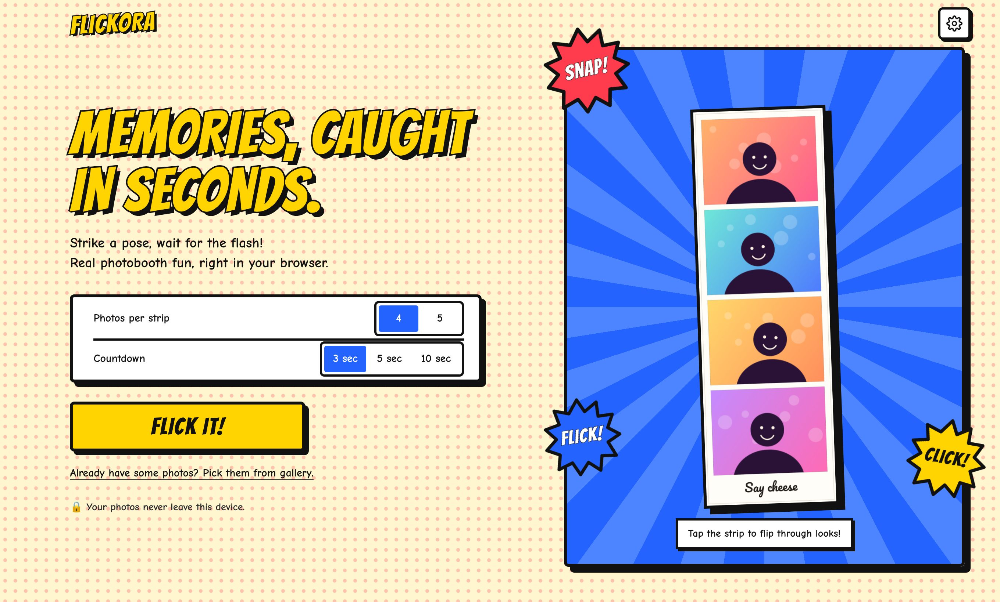
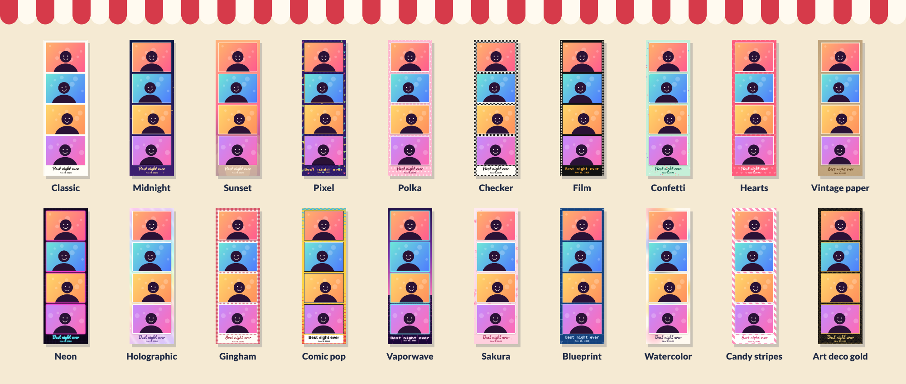
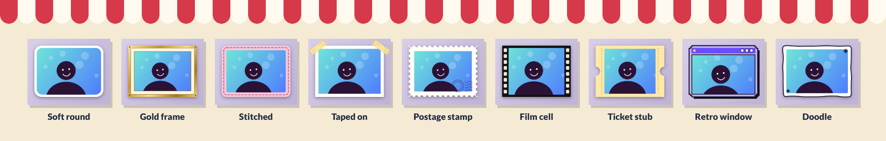
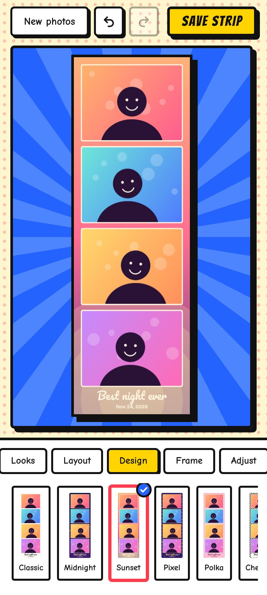

# 🎞️ Strip Booth

### Four poses. One strip.

A photobooth that lives in your browser. Strike a pose, wait for the countdown, and walk away with a photo strip you actually want to keep.

 

 

## ✨ The idea

Old photobooths are fun because everything about them is: the curtain, the countdown, the strip that drops out of the slot. Strip Booth brings that to any screen. Open it on a laptop or an Android phone, take four or five photos, and dress your strip with designs, frames, filters and stickers. No sign-up, no app store, nothing to install unless you want to.

> [!NOTE]
> **Your photos never leave your device.** There is no server, no account and no upload. Photos are processed right in the browser.

 

## 📸 Take the photos

<table>
<tr>
<td width="50%" valign="top">

**A real booth routine**
- 3, 5 or 10 second countdown
- 4 or 5 photos per strip
- Screen flash and synthesized shutter sounds
- Framing guide so everyone fits
- Retake any single pose without starting over

</td>
<td width="50%" valign="top">

**Works with what you have**
- Front and back camera switch on phones
- Gallery upload when the camera is blocked or missing
- Friendly help if camera permission is denied
- Same experience on desktop and Android

</td>
</tr>
</table>

 

## 🎨 Dress your strip 

 

### - 20 designs 

### - 9 photo frames that work on any design

 

<table>
<tr>
<td width="33%" valign="top">

### 🧩 5 layouts
Classic strip, grid, polaroids, wide strip, and big and small.

</td>
<td width="33%" valign="top">

### 🪄 10 filters
Original, black and white, sepia, vintage, warm, cool, vivid, faded, noir and pixel.

</td>
<td width="33%" valign="top">

### 🎀 24 stickers
Drag them anywhere, pinch to resize and turn, or use the buttons.

</td>
</tr>
<tr>
<td width="33%" valign="top">

### 🔍 Adjust each photo
Nobody lines up perfectly. Move and zoom every photo inside its slot with a drag, a pinch, the mouse wheel or sliders. Zoom up to 3x, reset one photo or all of them.

</td>
<td width="33%" valign="top">

### ✍️ Captions and dates
Write your own caption and show today's date, in script, pixel, handwritten, bold or typewriter lettering.

</td>
<td width="33%" valign="top">

### 🖼️ Always in sync
Every change shows up instantly in the preview, and the saved files match what you see, adjustments included.

</td>
</tr>
</table>

 

## 💾 Take it home

| Format | What you get |
| --- | --- |
| **PNG** | The full-quality strip, ready to post or print |
| **Animated GIF** | Your photos as a looping clip |
| **4 x 6 print sheet** | Two strips side by side, sized for a standard photo print |
| **Share** | Send it straight to another app from the Android share sheet |
| **Print** | Straight to a printer from the browser |

 

## 📱 Made for phones too

&nbsp;&nbsp;&nbsp;&nbsp;

 

Strip Booth is a **Progressive Web App**. On Android, open it in Chrome and choose **Install app** to get an icon on your home screen. After the first visit it keeps working with no connection at all.

 

---

Designed and built by **Rishi Jha**

[GitHub](https://github.com/rishi-maxxed) &nbsp;·&nbsp; [LinkedIn](https://linkedin.com/in/rishi-jha-xyz)

