

# 🎞️ Flickora

### Memories, caught in seconds.

A photobooth that lives in your browser. Strike a pose, wait for the countdown, and walk away with a photo strip you actually want to keep.

 

 

## ✨ The idea

Old photobooths are fun because everything about them is: the countdown, the flash, the strip that drops out of the slot. Flickora brings that to any screen. Open it on a laptop or an Android phone, take four or five photos, and dress your strip with designs, frames, filters and stickers. No sign-up, no app store, nothing to install unless you want to.

The look is **Comic Pop**: halftone paper, thick ink outlines, hard shadows, a blue sunburst behind your strip and big burst-style headlines in yellow.

> [!NOTE]
> **Your photos never leave your device.** There is no server, no account and no upload. Photos are processed right in the browser.

 

## 📸 Take the photos

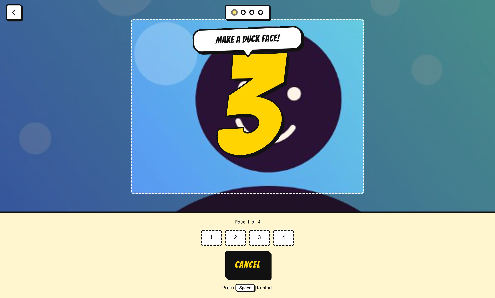

 

<table>
<tr>
<td width="50%" valign="top">

**A real booth routine**
- 3, 5 or 10 second countdown
- 4 or 5 photos per strip
- Screen flash and synthesized shutter sounds
- Pose prompts in a speech bubble ("Make a silly face!") that you can switch off in settings
- Press **Space** on a desktop browser to start the countdown
- Framing guide so everyone fits
- Retake any single pose without starting over

</td>
<td width="50%" valign="top">

**Works with what you have**
- Front and back camera switch on phones
- Gallery upload when the camera is blocked or missing
- Friendly help if camera permission is denied
- Same experience on desktop and Android

</td>
</tr>
</table>

 

## 🎨 Dress your strip

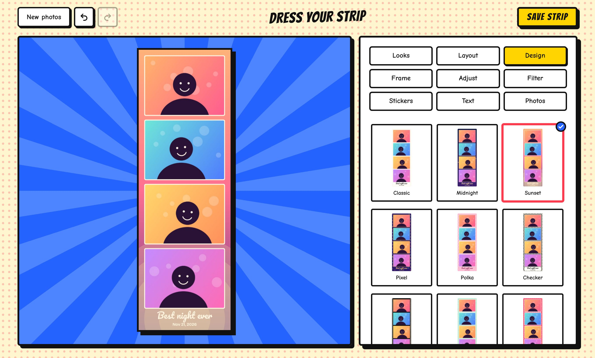

 

### A look at every tab

<table>
<tr>
<td width="25%" align="center">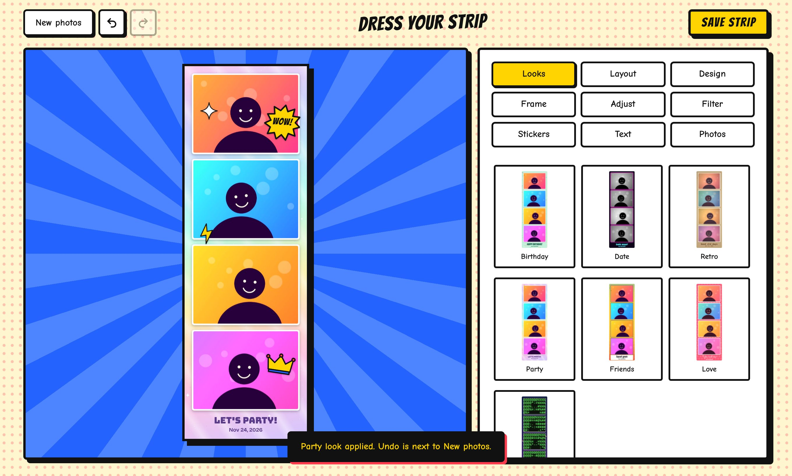 <b>Looks</b></td>
<td width="25%" align="center">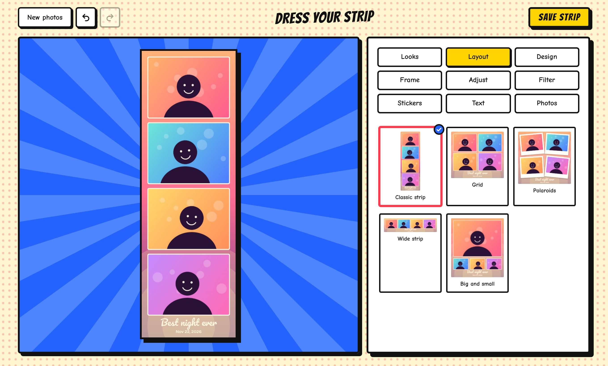 <b>Layout</b></td>
<td width="25%" align="center">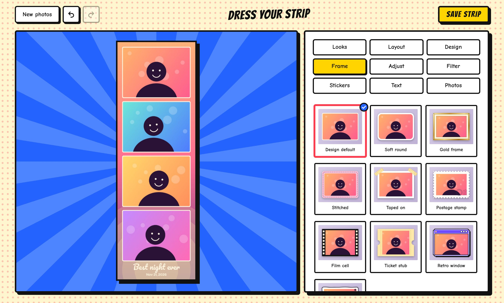 <b>Frame</b></td>
<td width="25%" align="center">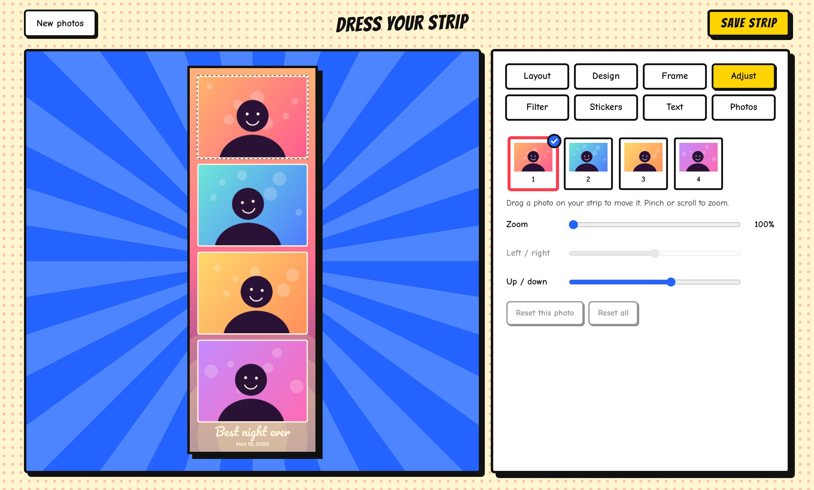 <b>Adjust</b></td>
</tr>
<tr>
<td width="25%" align="center">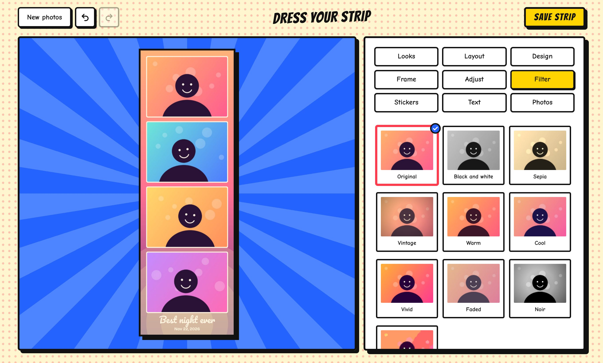 <b>Filter</b></td>
<td width="25%" align="center">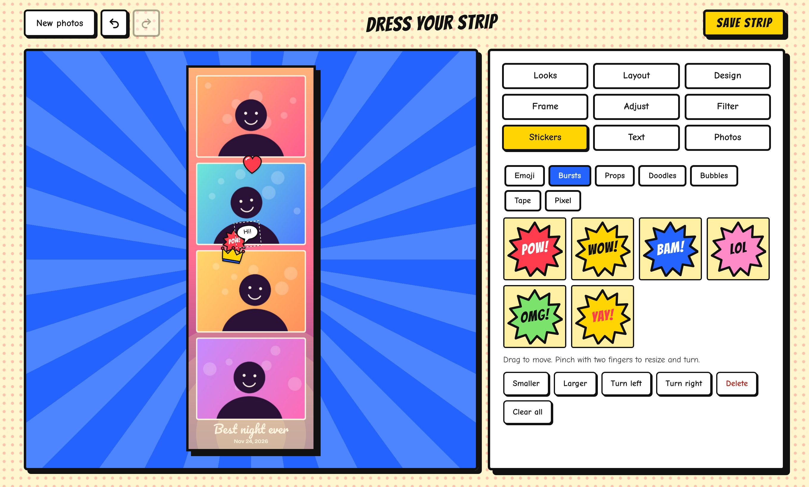 <b>Stickers</b></td>
<td width="25%" align="center">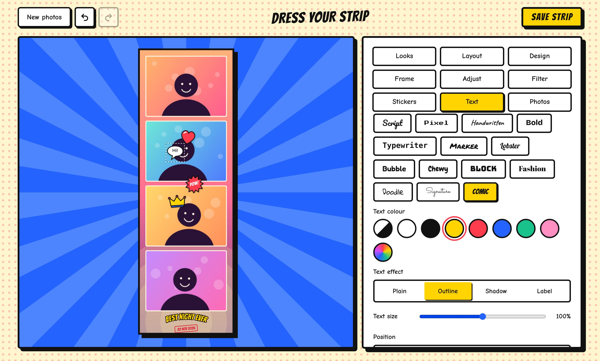 <b>Text</b></td>
<td width="25%" align="center">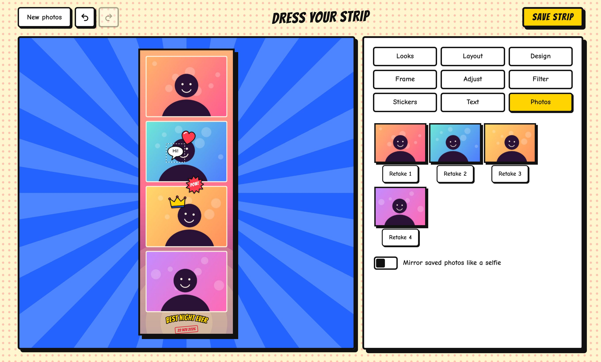 <b>Photos</b></td>
</tr>
<tr>
<td width="25%" align="center">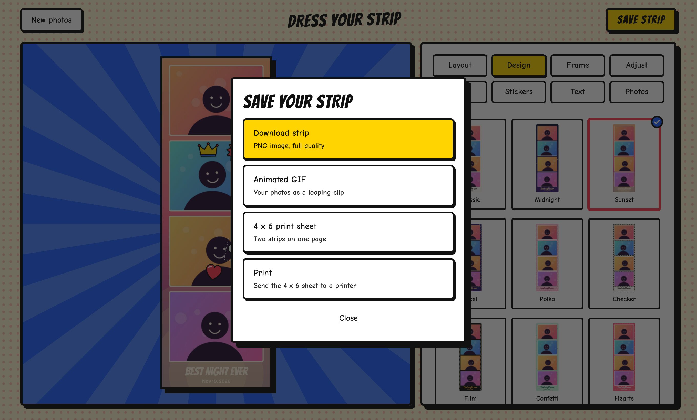 <b>Save</b></td>
</tr>
</table>

### ⚡ Quick looks, undo and redo

One tap on **Birthday**, **Date**, **Retro**, **Party**, **Friends** or **Love** sets the design, filter, caption, lettering and stickers together. Change your mind? **Undo** and **Redo** sit next to *New photos*, or use `Ctrl`/`Cmd` + `Z` and `Ctrl` + `Y` on a desktop.

 

### 20 designs

### 9 photo frames that work on any design

 

<table>
<tr>
<td width="33%" valign="top">

### 🧩 5 layouts
Classic strip, grid, polaroids, wide strip, and big and small.

</td>
<td width="33%" valign="top">

### 🪄 10 filters
Original, black and white, sepia, vintage, warm, cool, vivid, faded, noir and pixel.

</td>
<td width="33%" valign="top">

### 🎀 62 stickers
24 emoji plus 38 drawn comic stickers in six packs: bursts, booth props, doodles, speech bubbles, tape and stamps, and pixel icons. Drag them anywhere, pinch to resize and turn, or use the buttons.

</td>
</tr>
<tr>
<td width="33%" valign="top">

### 🔍 Adjust each photo
Nobody lines up perfectly. Move and zoom every photo inside its slot with a drag, a pinch, the mouse wheel or sliders. Zoom up to 3x, reset one photo or all of them.

</td>
<td width="33%" valign="top">

### ✍️ Captions and dates
Write your own caption in 14 lettering styles, then make it yours: any colour, plain, outline, shadow or label effect, size, left, centre or right, and a straight, arched or wavy line. The date comes in plain, film camera, digital and stamp styles.

</td>
<td width="33%" valign="top">

### 🖼️ Always in sync
Every change shows up instantly in the preview, and the saved files match what you see, adjustments included.

</td>
</tr>
</table>

 

## 💾 Take it home

| Format | What you get |
| --- | --- |
| **PNG** | The full-quality strip, ready to post or print |
| **Story size (9:16)** | A 1080 x 1920 image for Instagram and WhatsApp status |
| **Animated GIF** | Your photos as a looping clip |
| **4 x 6 print sheet** | Two strips side by side, sized for a standard photo print |
| **Share** | Send it straight to another app from the Android share sheet |
| **Print** | Straight to a printer from the browser |

 

## 📱 Made for phones too

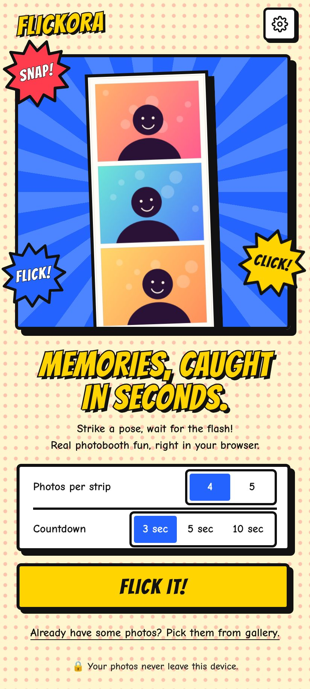
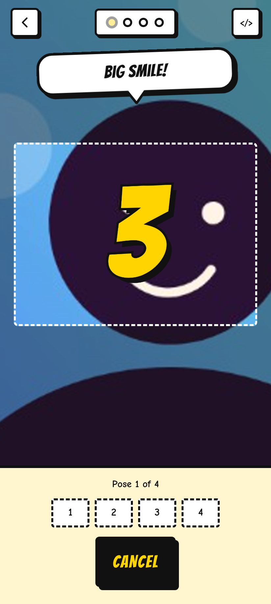

 

Flickora is a **Progressive Web App**. On Android, open it in Chrome and choose **Install app** to get an icon on your home screen. After the first visit it keeps working with no connection at all.

 

## 🔒 Privacy

Flickora has no server, no accounts, no analytics and no tracking. Photos stay in your browser's memory and are never uploaded. Camera access is used only while you are in the booth.

 

## 📄 License

The code, designs, frames, stickers and icons are open source under the [MIT License](LICENSE). Copyright (c) 2026 Rishi Jha.

Bundled fonts and the GIF library keep their own licenses, listed in [THIRD-PARTY-NOTICES.md](THIRD-PARTY-NOTICES.md).

 

**Memories, caught in seconds. No strings attached.**

 

---

Designed and built by **Rishi Jha**

[GitHub](https://github.com/rishi-maxxed) &nbsp;·&nbsp; [LinkedIn](https://linkedin.com/in/rishi-jha-xyz)

## Security and privacy

Photos stay on your device. See [SECURITY.md](SECURITY.md) for the protections in place and how to report a problem. When you use **Share**, the strip goes to the app you pick in your device's share sheet.
